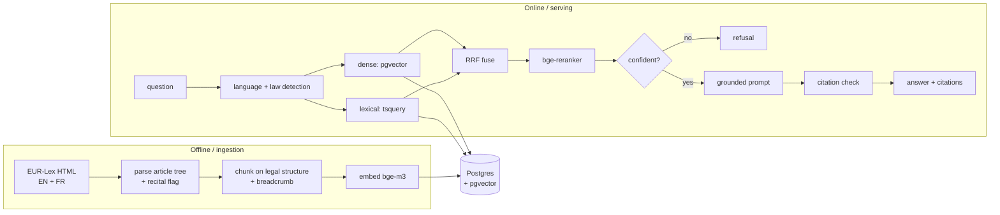

# EU-Law Assistant

**Ask a question about EU law in English or French; get an answer that cites the
exact article — or an honest refusal.**

A retrieval-augmented generation system over three EU legal texts (AI Act, GDPR,
Data Act). The interesting part is not that an LLM can answer: it is that every
retrieval change is measured on a hand-verified benchmark, citations are checked
against what was actually retrieved, and the system refuses instead of guessing.

[](https://github.com/alajamli/eu-law-assistant/actions/workflows/ci.yml)


> Source of truth: GitHub. Pushed commits are mirrored to
> [gitlab.com/alajamli/eu-law-assistant](https://gitlab.com/alajamli/eu-law-assistant)
> automatically by a workflow, so both copies stay on the same commit.

> **Status: Week 1 of 6.** Ingestion, schema, retrieval and the evaluation harness
> exist; answer generation and the UI land in Weeks 4–5. The table below is filled
> in from measured runs only — no placeholder numbers.

---

## Why it exists

EU legislation is public, bilingual, structured by article, and full of
cross-references ("as referred to in Article 6(1)"). That makes it a good stress
test for the parts of RAG that are usually skipped:

| Typical shortcut | What this project does instead |
| --- | --- |
| Fixed 500-token chunks | Chunk on legal structure, with a heading breadcrumb on every chunk |
| "It looks good" | A ~100-question hand-verified golden set, scored every run |
| One big change, no comparison | An ablation table; each change measured separately, regressions reported |
| No refusal path | Unanswerable questions in the benchmark, refusal accuracy measured |
| Citations that are hallucinated | Every cited article is verified against the retrieved set |
| English-only | Bilingual EN/FR, with per-language lexical search |

## What it does and does not do

**Does**

- answers with inline citations such as `[AI Act, Art. 5(1)(a)]`;
- refuses when the retrieved evidence is below a tuned threshold, without calling
  the LLM;
- says "not found in the provided sources" instead of answering from memory;
- exposes retrieval (`/api/search`) separately from generation (`/api/ask`);
- records every experiment as a file keyed by git commit.

**Does not**

- give legal advice;
- claim to be an official EU source;
- use agents, knowledge graphs or multi-agent frameworks;
- fine-tune the generator.

## Quickstart

```bash
git clone https://github.com/alajamli/eu-law-assistant.git
cd eu-law-assistant
cp .env.example .env            # add GROQ_API_KEY (free: console.groq.com/keys)

docker compose up --build -d db # Postgres 16 + pgvector, schema applied automatically

python -m venv .venv && . .venv/Scripts/activate   # Windows
pip install -e ".[dev]"
pytest -q                       # 46 tests, no model download needed
```

Ingest the corpus (downloads 6 EUR-Lex documents via the Publications Office
Cellar endpoint, then chunks and embeds them):

```bash
python -m ingest.cli download   # 6 XHTML files, validated and cached in data/raw/
python -m ingest.cli parse      # 113 AI Act + 99 GDPR + 50 Data Act articles, both languages
python -m ingest.cli index      # needs the `ml` extra: pip install -e ".[ml]"
```

For a torch-free smoke test, replace the last line with
`python -m ingest.cli index --embedding-backend hashing` and set
`EMBEDDING_BACKEND=hashing`. The vectors are then meaningless but the whole path
— schema, SQL, fusion, API — is exercised. Never index with one backend and query
with the other.

Run the API:

```bash
uvicorn api.main:app --reload   # docs at http://localhost:8000/docs
curl -s localhost:8000/health
```

Run the frontend (separate terminal):

```bash
cd web && npm install && npm run dev   # http://localhost:5173
```

## Architecture



More detail: [docs/DESIGN.md](docs/DESIGN.md) ·
[docs/ARCHITECTURE.md](docs/ARCHITECTURE.md) ·
[docs/DECISIONS.md](docs/DECISIONS.md)

## Repository layout

```
ingest/     EUR-Lex download, article parser, structure-aware chunking, embeddings
retrieval/  dense + lexical search, RRF fusion, reranking, query detection
api/        FastAPI app: /health, /api/search, /api/ask
evals/      golden set, metrics, run.py, results/
web/        React + Vite client
db/init/    Postgres schema (pgvector, tsvector trigger, caches)
docs/       design, architecture, decisions, data, evaluation, failures
tests/      parser, chunker, RRF, metrics, API contract — no DB or model needed
```

## Results

Measured on `evals/golden/questions.jsonl`. Regenerate with
`python -m evals.run --config <name>`; every file records the git commit.

| Config | Recall@5 | Recall@10 | MRR | Faithfulness | p50 latency |
| --- | --- | --- | --- | --- | --- |
| v0 — vector only | — | — | — | — | — |
| + hybrid (RRF) | — | — | — | — | — |
| + rerank | — | — | — | — | — |
| + query rewrite | — | — | — | — | — |

Empty cells mean "not measured yet", not "good enough". Method:
[docs/EVALS.md](docs/EVALS.md).

## Design decisions worth arguing about

- **Postgres for everything** — vectors, lexical search, history and caches in one
  database. Fewer moving parts, and the hybrid query is one family of SQL.
- **Chunking on legal structure** — an article paragraph is a unit a human can
  cite; 500 tokens is not.
- **Retrieval metrics gate CI, LLM-judge metrics do not** — a gate that fails on a
  provider outage teaches you to ignore the gate.
- **Recitals are retrievable but flagged** — a recital is not a legal obligation,
  and presenting it as one is the failure lawyers notice first.
- **No ML models in the API container** — `bge-m3` and the reranker do not fit in a
  free tier; pretending they do breaks the deploy in week 5, not week 0.

## Data and licence

Legal texts © European Union, reproduced from **EUR-Lex**, reused under Commission
Decision 2011/833/EU. This project is not an official EU source, is not endorsed by
the EU, and does not provide legal advice. Details and caveats:
[docs/DATA.md](docs/DATA.md). Code is MIT — see [LICENSE](LICENSE).

## Roadmap

| Week | Deliverable | Status |
| --- | --- | --- |
| 0 | Repo, schema, Compose, CI on an empty test | done |
| 1 | Ingestion + v0 baseline answering with article numbers | in progress |
| 2 | Golden set + eval harness, `results/v0.json` | todo |
| 3 | Ablation: hybrid, rerank, rewrite, filters, parent-doc | todo |
| 4 | Grounded prompt, citation check, refusal, tracing | todo |
| 5 | React UI, PR eval gate, public deploy | todo |
| 6 | Demo video, blog post, failure analysis | todo |

Definition of done: public demo URL · ~100 hand-verified questions · ablation table
with ≥4 configurations · CI eval gate · measured citation verification and refusal
· traces · README + video + post.
