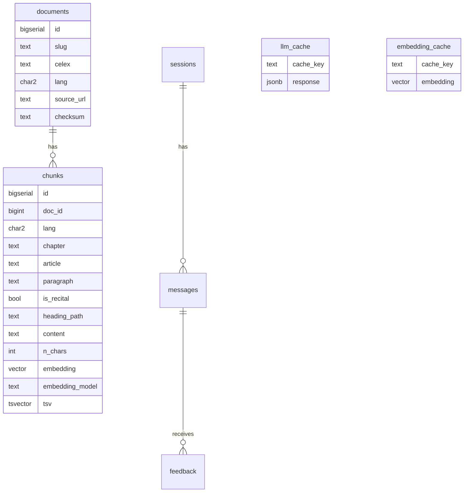
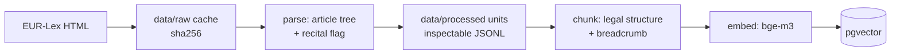
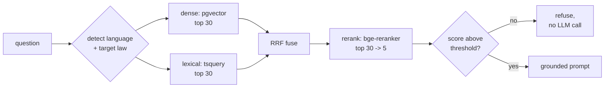

# Architecture

## Layout

```
ingest/     EUR-Lex download -> parse -> chunk -> embed -> Postgres
retrieval/  dense + lexical search, RRF fusion, reranking, query parsing
api/        FastAPI app, settings, DB pool, request/response models
evals/      golden set, metrics, run.py, results/
web/        React + Vite client
db/init/    schema applied on first container start
infra/      Dockerfiles
docs/       design, architecture, decisions, data, eval method
```

Each stage is a separate importable package, so an experiment is a keyword
argument rather than a fork:

```python
from retrieval.pipeline import Retriever

Retriever(use_hybrid=False, use_rerank=False)   # the v0 baseline
Retriever(use_hybrid=True,  use_rerank=True)    # current best
```

## Data model



`chunks` has one row per retrievable unit. Two derived columns do the heavy
lifting:

- `tsv` — filled by a trigger with `english` or `french` depending on `lang`.
  A generated column cannot do this, because the config must vary per row.
- `embedding` — `vector(1024)`, HNSW cosine index.

`embedding_model` is stored per row so a model change is detectable instead of
silently mixing incompatible vectors.

## Ingestion pipeline



Caching is a requirement, not an optimisation: re-running ingestion must not
re-download from a shared public service. `checksum` records what was indexed.

## Retrieval



The language/law detection is deliberately rule-based: it runs on every request,
must be free, and must never fail. LLM query rewriting arrives in Week 3 and has
to earn its place in the ablation table.

## Failure modes we design against

| Failure | Guard |
| --- | --- |
| Citing an article that was not retrieved | citation check in Week 4: strip or flag unknown ids |
| Answering from model memory | prompt requires "not found in the provided sources" when context is missing |
| Recital cited as binding law | `is_recital` flag, surfaced in the citation |
| French questions hitting an English analyser | per-row `tsvector` config |
| Silent article loss during parsing | `parse` writes inspectable JSONL; `count_articles` guards the tests |
| Re-ingestion duplicating rows | `UNIQUE NULLS NOT DISTINCT` + upsert |
| Eval numbers drifting from the code | `commit` recorded in every result file |
