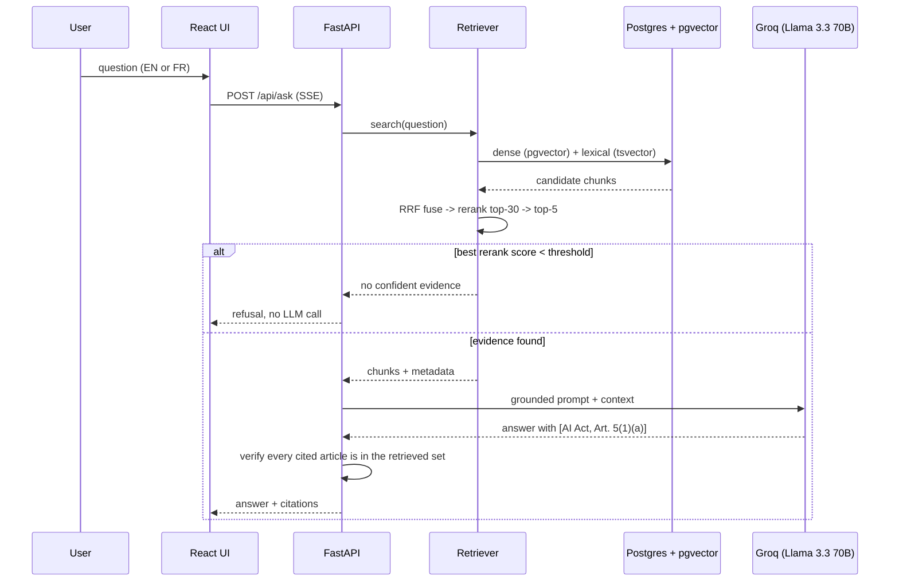

# Design

One page, kept current. If a decision here changes, it changes with an ADR in
[DECISIONS.md](DECISIONS.md).

## Goal

A bilingual (EN/FR) question-answering system over three EU legal texts that:

- answers **only** from the retrieved text, with an inline citation to the exact
  article and paragraph;
- **refuses** when the answer is not in the corpus, and says so;
- reports its own quality with a **hand-verified benchmark**, and every retrieval
  change is measured against the previous configuration.

## Non-goals

- No agents, no multi-agent framework, no knowledge graph (that is project 3 of
  the roadmap).
- No fine-tuning of the generator.
- Not legal advice, and not an official EU source. See [DATA.md](DATA.md).
- No design system: the UI stays minimal on purpose.

## Why this corpus

EUR-Lex publishes the AI Act, GDPR and Data Act in EN and FR, free, in HTML that
is structured by article. That gives three things at once: a real multilingual
corpus, a chunking problem where naive fixed-size chunking visibly fails, and
citations that a reader can verify in one click.

## Primary user flow

## Corpus and chunking

| Document | CELEX | EN | FR |
| --- | --- | --- | --- |
| AI Act | 32024R1689 | yes | yes |
| GDPR | 32016R0679 | yes | yes |
| Data Act | 32023R2854 | yes | yes |

Measured on the live corpus: 5.6 MB of XHTML → 262 articles per language →
**2 213 chunks** (1 080 EN / 1 133 FR), of which 944 are recital chunks. Article
counts are asserted against the real documents, not assumed: 113 AI Act, 99 GDPR,
50 Data Act.

Parsing keeps `document > chapter > section > article > paragraph` and flags
recitals, which are **not binding law**. Chunks are built on legal structure,
never on a fixed token count, and each chunk carries its heading breadcrumb so it
still makes sense when read alone.

## Where the numbers come from

The golden set lives in `evals/golden/questions.jsonl` and every row is
hand-verified before it counts. Retrieval is scored with Recall@k, hit rate and
MRR. Generation is scored for faithfulness, correctness and refusal accuracy,
with a measured judge-agreement rate. See [EVALS.md](EVALS.md).

## Milestones

| Week | Deliverable | Status |
| --- | --- | --- |
| 0 | Repo, schema, Compose, CI green on an empty test | **done** |
| 1 | Ingest + v0 baseline answering with article numbers | in progress |
| 2 | Golden set + eval harness, `v0.json` saved | todo |
| 3 | Ablation: hybrid, rerank, rewrite, filters, parent-doc | todo |
| 4 | Grounded prompt, citation check, refusal, tracing | todo |
| 5 | React UI, PR eval gate, public deploy | todo |
| 6 | README, demo video, blog post | todo |
